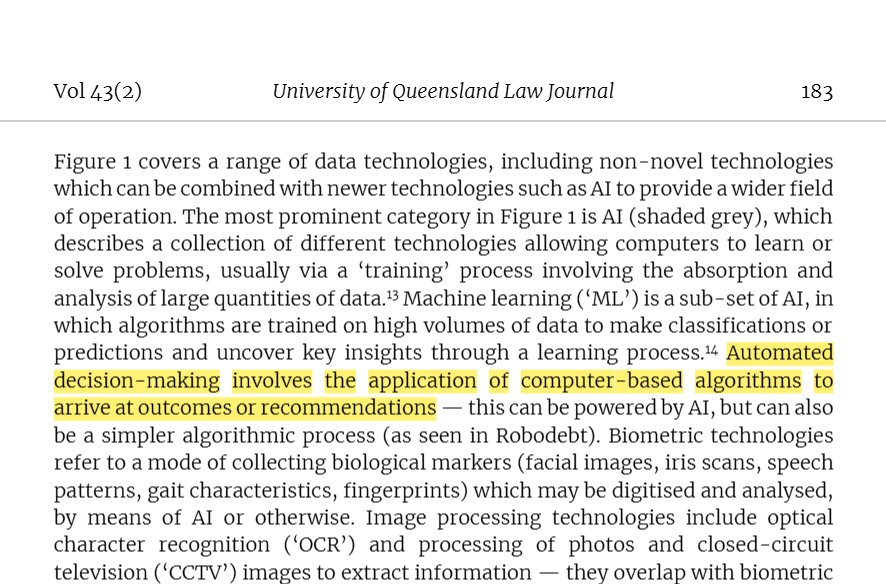
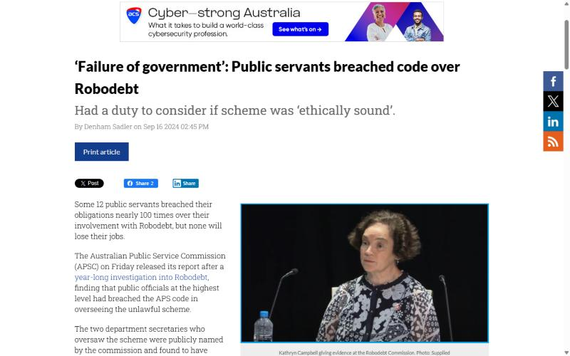
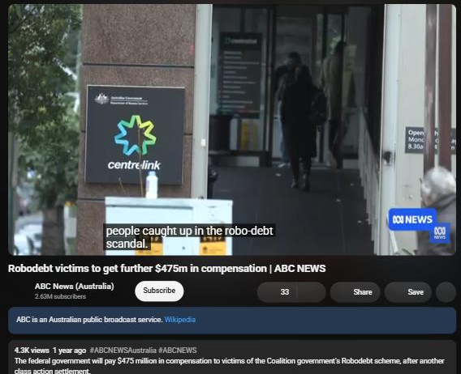
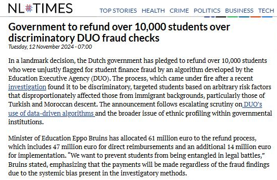
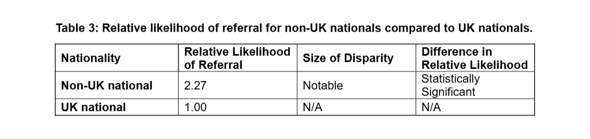

# e-portfolio-5-Automated-Decision-Making
COIT11223 Assessment 3 Q2: e-portfolio on Automated Decision-Making in government (Pratik Sangraula, 12324885)

Six items that show the process through which I have learned about ADM in government. The first three items cover the issue of Robodebt in Australia in three aspects: legal issues, accountability and cost. The other three show similar issues in the Netherlands, Sweden, and the UK. Before starting this unit, I used to see ADM as a neutral instrument that increased efficiency in government. Now I see it as a series of human decisions that define whom to assist, whom to investigate and whom to ignore.

---

## Artefact 1: What the law says about ADM (Australia, journal article)

https://doi.org/10.38127/uqlj.v43i2.8311

### Summary of the artefact
According to Hildenbrand (2024, p. 183), automated decision making can be defined as “the use of computer algorithm[s] to reach a decision or recommendation”. Relying on Robodebt as her primary example, Hildenbrand makes the case that Australian privacy and data protection legislation has shortcomings when used in conjunction with novel data technologies by the government, and human rights legislation could remedy these shortcomings. Hildenbrand is emphatic that "Robodebt caused considerable injustice and harm to people" (Hildenbrand 2024, p. 180).

### Justification on why I chose the artefact
This particular article was chosen because it helped me define precisely what ADM is and how the law is lagging behind in keeping up with technology. The link with social contract theory is the idea that people delegate authority to the government in exchange for protection of their rights. If there are any loopholes in the law, this can be exploited, as with Robodebt.

---

## Artefact 2: The people behind Robodebt (Australia, news)

https://ia.acs.org.au/article/2024/-failure-of-government---public-servants-breached-code-over-robo.html

### Summary of the artefact
The article from the Information Age is based on the one-year investigation conducted by the Australian Public Service Commission about Robodebt. All 12 individuals under investigation were found to have violated the APS code of conduct with 97 violations altogether. Gordon de Brouwer, the commission's head, considered Robodebt "a failure of the government" and noted that public servants have a responsibility to "consider if a decision is ethical or not" (Sadler 2024).

### Justification on why I chose the artefact
Robodebt was an instance where my perception of accountability has been altered since it was not simply a bad piece of software, but people have made decisions to keep it going. The reason behind this is that the artefact relates directly to the ACS Code of Conduct where value 1.2.4 requires me to be accountable for my actions (ACS 2014).

---

## Artefact 3: Robodebt, the final bill (Australia, YouTube video)

https://www.youtube.com/watch?v=BKPQ1iZgAL8

### Summary of the artefact
The following is an ABC News video that was released in September of 2025 where the federal government has promised to pay additional funds amounting to $475 million to reach a settlement for a Robodebt class action case. The Robodebt system made use of income averaging to automatically increase welfare debts, many of which were not actually owed (ABC News (Australia) 2025).

### Justification on why I chose the artefact
The Robodebt scheme is the most relevant case for an Australian ICT student to know, and knowing the final price tag was eye opening for me. Under the concept of act utilitarianism, any savings that were going to be made by the program were negated by its negative impact and the price tag. Furthermore, it violates value 1.2.1 of the ACS, which places public interest before all else (ACS 2014).

---

## Artefact 4: Students flagged by an algorithm (Netherlands, news)

https://nltimes.nl/2024/11/12/government-refund-10000-students-discriminatory-duo-fraud-checks

### Summary of the artefact
The algorithm used by the Dutch Student Finance Agency, DUO, back in 2012 to single out students who should undergo fraud checks, relied among other parameters on the age of the students and the kind of education they pursued, as well as how close they lived to their parents. Students of migrant background were singled out far more often.

### Justification on why I chose the artefact
I was personally affected by this problem since I am a student. Even though the algorithm did not ask the question of the race of the people, it still used some indicators to choose migrant students. This means that eliminating such an indicator does not necessarily mean that you will eliminate the problem. Kant would say that people were treated not as individuals but as a part of society.

---

## Artefact 5: Sweden's "suspicion machine" (Sweden, investigation)

https://www.lighthousereports.com/investigation/swedens-suspicion-machine/

### Summary of the artefact
An algorithm that was being used by the Swedish Social Insurance Agency to identify individuals suspected of welfare fraud was scrutinized by reporters from Lighthouse Reports and Svenska Dagbladet. Using more than 6,000 cases flagged by the algorithm, with input from academics, the journalists determined that the tool was biased against women, immigrants, lower income workers, and individuals without college educations (Lighthouse Reports & Svenska Dagbladet 2024).

### Justification on why I chose the artefact
The findings of this study have shown a similar trend to the Dutch example, with the issue of secrecy being an additional concern. In response to the question on transparency, the head official said, "I do not think we need to be." This contravenes ACS value 1.2.3 Integrity, which demands that no one should lie to those who are affected by the system. As a cybersecurity student, I learned that secrecy can be used to shield even a flawed system.

---

## Artefact 6: The UK tests its own algorithm (United Kingdom, government report)

https://assets.publishing.service.gov.uk/media/6876219388da2e5804bb6a17/UC_Advances_model_fairness_assessment_-_July_2025.pdf

### Summary of the artefact
The Department for Work and Pensions in the UK employs machine learning algorithms to risk rate applications for advanced Universal Credit payments, which are then escalated to staff members for further evaluation. According to the fairness report conducted by the department in July 2025, non-UK nationals were twice as likely to be escalated, and for certain ages, the algorithm was not working "as effectively as we would expect". However, the department retained the use of the algorithm and pledged to train it again (Department for Work and Pensions 2025).

### Justification on why I chose the artefact
Unlike the previous examples, in this case, we see the government itself conducting the test for fairness on its own website. This changed my opinion; it is not about banning ADM at all but rather about testing it openly. According to the rule utilitarianism, a rule about testing each governmental model and making the results known would lead to more goodness overall.

---

## Why this matters to me as an ICT professional

For all six artifacts, the harm was a result of the design and omission of information, not just the technology itself. As an emerging cybersecurity professional, I am the one who will test, build, or approve such systems. The ACS Code instructs me to place public interest above all else (ACS 2014). This means that I will examine whether there is any bias in a decision, and consider how the decision can be questioned.

---

## References

ABC News (Australia) 2025, *Robodebt victims to get further $475m in compensation | ABC NEWS*, YouTube, 4 September, viewed 8 October 2026, <https://www.youtube.com/watch?v=BKPQ1iZgAL8>.

Australian Computer Society (ACS) 2014, *ACS code of professional conduct*, version 2.1, ACS, Sydney, viewed 8 October 2026, <https://www.acs.org.au/content/dam/acs/rules-and-regulations/Code-of-Professional-Conduct_v2.1.pdf>.

Department for Work and Pensions 2025, *UC Advances model: fairness assessment*, GOV.UK, London, viewed 8 October 2026, <https://assets.publishing.service.gov.uk/media/6876219388da2e5804bb6a17/UC_Advances_model_fairness_assessment_-_July_2025.pdf>.

Hildenbrand, SS 2024, 'Robodebt and novel data technologies in the public sector: how human rights laws plug data protection gaps', *University of Queensland Law Journal*, vol. 43, no. 2, viewed 8 October 2026, <https://doi.org/10.38127/uqlj.v43i2.8311>.

Lighthouse Reports & Svenska Dagbladet 2024, 'Sweden's suspicion machine', *Lighthouse Reports*, 27 November, viewed 8 October 2026, <https://www.lighthousereports.com/investigation/swedens-suspicion-machine/>.

NL Times 2024, 'Government to refund over 10,000 students over discriminatory DUO fraud checks', *NL Times*, 12 November, viewed 8 October 2026, <https://nltimes.nl/2024/11/12/government-refund-10000-students-discriminatory-duo-fraud-checks>.

Sadler, D 2024, '"Failure of government": public servants breached code over Robodebt', *Information Age*, 16 September, viewed 8 October 2026, <https://ia.acs.org.au/article/2024/-failure-of-government---public-servants-breached-code-over-robo.html>.

---

## Statement on AI use

I used an AI assistant to help find sourcing the candidates of this portfolio, planning its structure, writing the summaries and the justifications of sources. I have individually verified all the artifacts and references.
